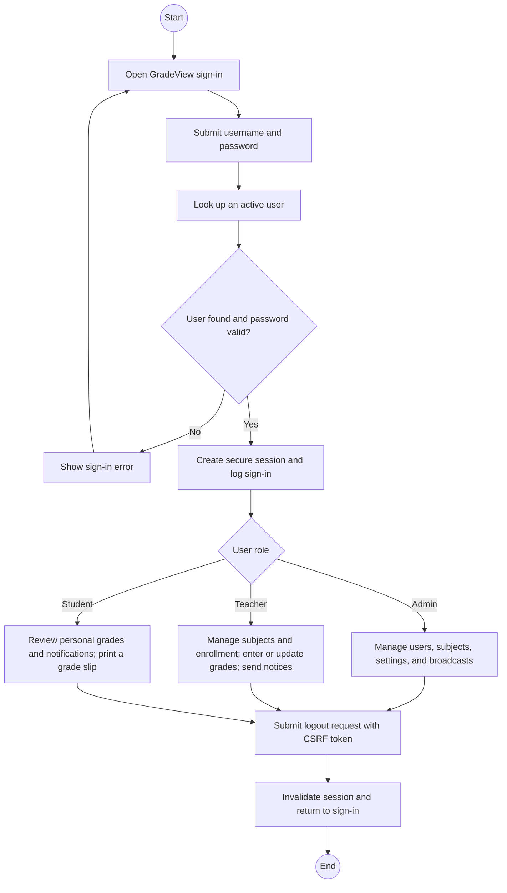
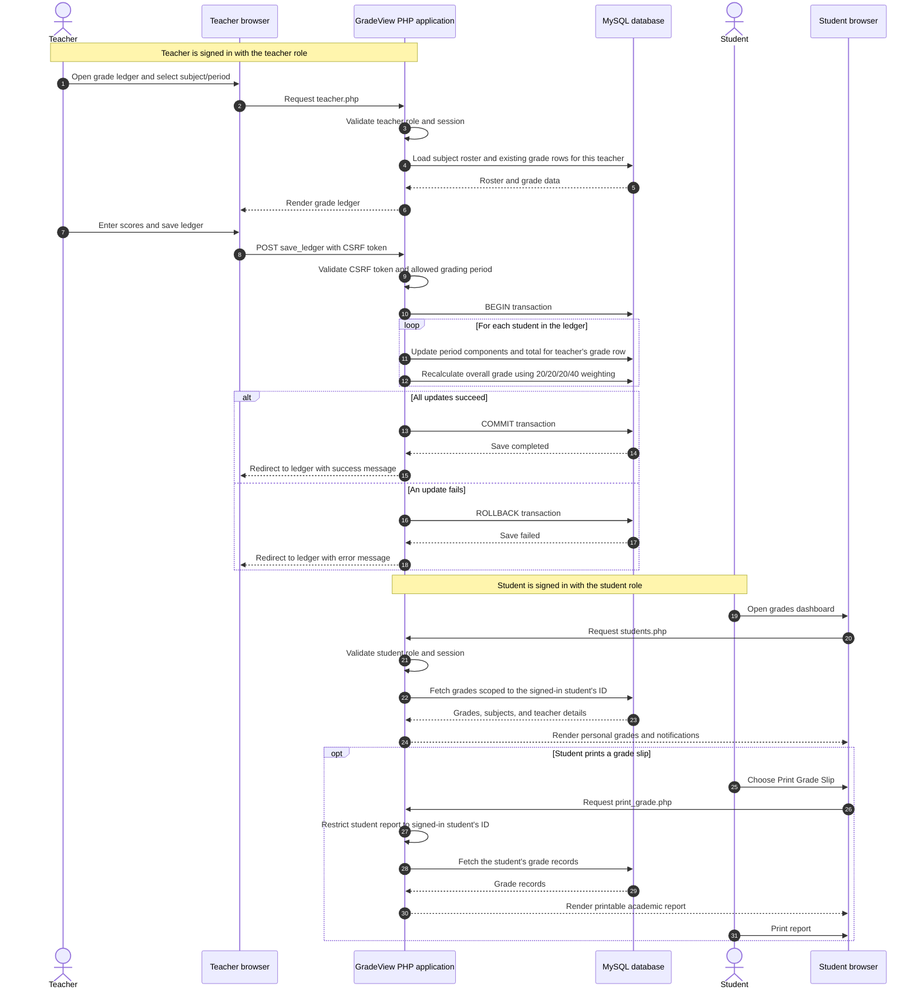

# GradeView System Diagrams

These diagrams describe the current PHP application and its MySQL-backed workflows. The Mermaid blocks render as diagrams in GitHub and in Markdown previews that support Mermaid.

## Activity diagram

This diagram shows the shared sign-in flow followed by the available actions for each role.

## Sequence diagram

This sequence follows a teacher saving grades for an existing subject roster, then a student viewing those grades and optionally printing a grade slip. The saved overall grade uses the current server-side weighting: prelim 20%, midterm 20%, prefinal 20%, and final 40%.

